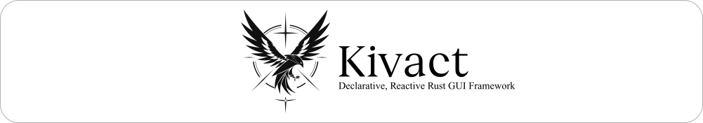
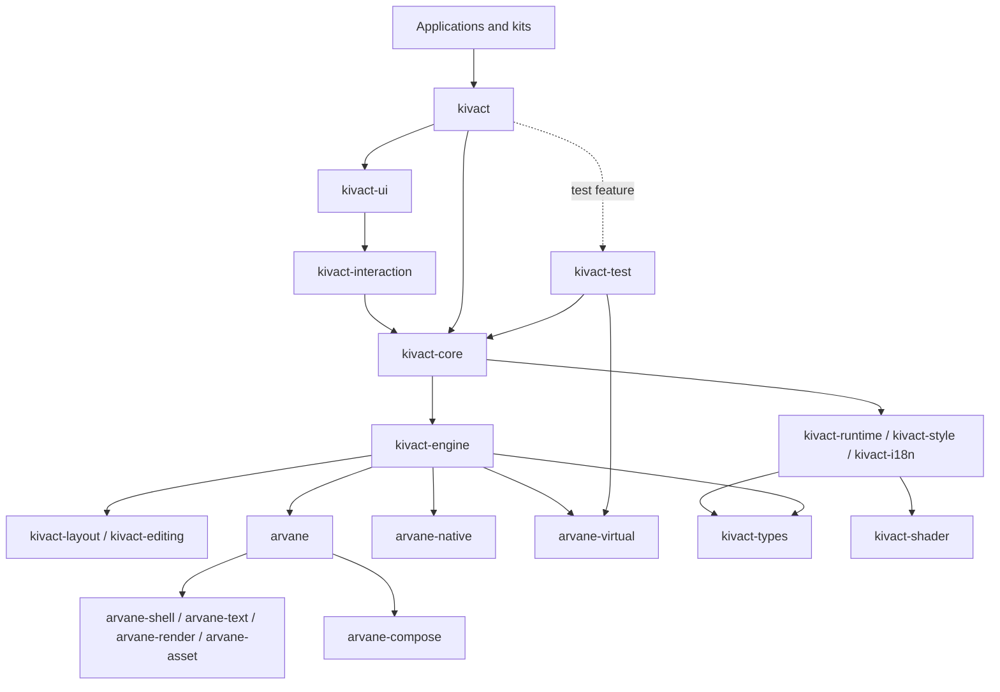

# Kivact

[日本語](README_JP.md)

Kivact is a native GUI framework for Rust. Components are plain functions
that run once; fine-grained signals update only the parts of the screen that
read them. The model will be familiar to React and SolidJS developers, and
the same codebase holds the application's Rust domain logic.

> **Status: early development.** APIs and crate layout change without
> notice and there is no release yet. Bug reports are welcome as issues;
> pull requests are not accepted for now.

```rust,no_run
use kivact::prelude::*;

fn counter() -> impl IntoView {
    let count = signal(0);
    column((
        text(move || format!("count: {}", count.get())),
        button("Increment").on_press(move || count.update(|n| *n += 1)),
    ))
    .style(style().gap(8).padding(16))
}

fn main() -> kivact::Result<()> {
    App::new("Counter").run(counter)
}
```

The root setup runs once when the App mounts it. Use
`scope(move || view)` for a child that needs its own once-mounted setup
and cleanup owner. Dynamic properties read signals inside closures.
Runtime image and font inputs accept owned `Vec<u8>` or `AssetBytes`; keep
an asset and clone it when reused so its cache identity stays stable.

## Features

- **Plain functions and signals.** `signal`, `memo`, `effect` and keyed
  lists, with no virtual DOM and no re-rendering of whole components.
  `#[component]` writes the props builder of a function that takes props.
- **Standard components.** Buttons, inputs, selects, dialogs, menus, tabs,
  tables, toasts and more in `kivact::ui`, styled by the active theme.
- **Accessibility by default.** Every component exposes role, name and state
  to the platform's assistive technologies and works with the keyboard.
- **App-wide testing.** `kivact::test` drives the complete App by role and
  name on `arvane-virtual`, using the production rendering driver and a
  virtual clock. Local runs can mirror the result in a native window.
- **Text and input.** CJK, combining characters, bidirectional text and IME
  composition.
- **Drawing.** A Canvas with an HTML Canvas–like vocabulary, frames from the
  application's own renderer, and off-screen image export.
- **UI kits.** Five official kits restyle the standard components and add
  domain components, built only on the public API.

## Getting started

Kivact is not published on crates.io yet. Depend on the Git repository:

```toml
[dependencies]
kivact = { git = "https://github.com/Kashiwade-music/kivact" }

[dev-dependencies]
kivact = { git = "https://github.com/Kashiwade-music/kivact", features = ["test"] }
```

The toolchain is pinned in [`rust-toolchain.toml`](rust-toolchain.toml).
Start with the [tutorial](docs/for-kivact-user/en/getting-started/README.md).

To run the examples, clone the repository and run from its root:

```text
cargo run -p kivact-example-counter
cargo run -p kivact-example-form
cargo run -p kivact-example-list
cargo run -p kivact-example-async
cargo run -p kivact-example-component
cargo run -p kivact-ui-basic-catalog
```

## Documentation

| Audience | English | 日本語 |
|---|---|---|
| Application developers | [Kivact guide](docs/for-kivact-user/en/README.md) | [Kivact ガイド](docs/for-kivact-user/jp/README.md) |
| UI kit users | [UI kit guide](docs/for-kivact-ui-user/en/README.md) | [UI キット ガイド](docs/for-kivact-ui-user/jp/README.md) |
| Kivact developers | — | [Architecture](docs/for-kivact-developer/architecture.md), [decisions](docs/for-kivact-developer/decisions.md), [strategy](docs/for-kivact-developer/strategy.md) |

The API reference is the rustdoc: `cargo doc -p kivact --open`.

## Workspace crates

The workspace contains 49 packages. Application code uses `kivact` and,
optionally, a UI kit; the remaining library boundaries separate the runtime,
engine, backend and test harness. This diagram shows the main dependency paths;
see the [architecture guide](docs/for-kivact-developer/architecture.md) and
[generated graphs](architecture/) for the full graph.



| Crate | Path | Purpose |
|---|---|---|
| `kivact` | `crates/kivact` | Application and component-author facade. |
| `kivact-macros` | `crates/kivact-macros` | The `#[component]` attribute that writes a component's props builder (re-exported by `kivact`). |
| `kivact-core` | `crates/kivact-core` | View descriptions, mounting, input and application launch. |
| `kivact-test` | `crates/kivact-test` | App-wide E2E harness exposed as kivact::test. |
| `kivact-devtools-protocol` | `crates/kivact-devtools-protocol` | Wire vocabulary shared by the DevTools agent, app, MCP server and Python client. |
| `kivact-devtools-agent` | `crates/kivact-devtools-agent` | The DevTools server inside a target app: socket, discovery and PNG images. |
| `kivact-devtools-client` | `crates/kivact-devtools-client` | Discovery and typed calls to a DevTools agent. |
| `kivact-devtools` | `crates/kivact-devtools` | The DevTools desktop app. |
| `kivact-devtools-mcp` | `crates/kivact-devtools-mcp` | MCP server that exposes a DevTools target over stdio. |
| `kivact-public-api-tests` | `dev/tests/kivact-public-api` | Public consumer E2E and offscreen contracts. |
| `kivact-runtime` | `crates/kivact-runtime` | Reactive owners, signals, Machines, tasks and motion. |
| `kivact-i18n` | `crates/kivact-i18n` | Locales, messages and date/number formatting. |
| `kivact-style` | `crates/kivact-style` | Styles, themes, tokens and drawing vocabulary. |
| `kivact-shader` | `crates/kivact-shader` | Validates user WGSL shaders and assembles the complete shader modules. |
| `kivact-interaction` | `crates/kivact-interaction` | Headless behavior, semantics and input controllers. |
| `kivact-ui` | `crates/kivact-ui` | Canonical standard components and recipe contracts. |
| `kivact-ui-basic` | `crates/kivact-ui-basic` | Neutral general-purpose kit inspired by shadcn/ui Lyra. |
| `kivact-ui-pop` | `crates/kivact-ui-pop` | Calm, compact work-application kit. |
| `kivact-ui-game` | `crates/kivact-ui-game` | Game-style control panels and HUDs. |
| `kivact-ui-creative` | `crates/kivact-ui-creative` | Creative editing tools, docks and inspectors. |
| `kivact-ui-soft` | `crates/kivact-ui-soft` | Astryx Neutral in light and dark appearances. |
| `kivact-engine` | `crates/kivact-engine` | Retained UI tree, scene generation and backend driving. |
| `kivact-editing` | `crates/kivact-editing` | Document, edit-session and native text-input contracts. |
| `kivact-layout` | `crates/kivact-layout` | Borrowed-tree layout and derived geometry. |
| `kivact-docs` | `dev/tests/docs` | Compile and run Markdown Rust examples as doctests. |
| `kivact-template-basic` | `templates/basic` | Minimal standalone application template with a test. |
| `kivact-example-counter` | `examples/kivact/counter` | Signal-driven counter example. |
| `kivact-example-form` | `examples/kivact/form` | Form validation example. |
| `kivact-example-list` | `examples/kivact/list` | Keyed list example. |
| `kivact-example-async` | `examples/kivact/async` | Resource loading example. |
| `kivact-example-component` | `examples/kivact/component` | Reusable component composition example. |
| `kivact-ui-basic-catalog` | `examples/kivact-ui-basic` | Basic kit interactive catalog. |
| `kivact-ui-pop-catalog` | `examples/kivact-ui-pop` | Pop kit interactive catalog. |
| `kivact-ui-game-catalog` | `examples/kivact-ui-game` | Game kit interactive catalog. |
| `kivact-ui-creative-catalog` | `examples/kivact-ui-creative` | Creative kit interactive catalog. |
| `kivact-ui-soft-catalog` | `examples/kivact-ui-soft` | Soft kit interactive catalog. |
| `arvane` | `crates/arvane` | Portable window, text, rendering and asset facade. |
| `kivact-types` | `crates/kivact-types` | Neutral geometry, events, assets and immutable snapshots. |
| `arvane-native` | `crates/arvane-native` | Native windows, input, presentation and accessibility. |
| `arvane-shell` | `crates/arvane-shell` | Backend SPI and portable window/input vocabulary. |
| `arvane-virtual` | `crates/arvane-virtual` | Scripted backend using the same rendering driver, with optional mirrors. |
| `arvane-text` | `crates/arvane-text` | Font discovery and text shaping adapter. |
| `arvane-render` | `crates/arvane-render` | Vello 2D rasterization of render scenes. |
| `arvane-compose` | `crates/arvane-compose` | Composition plans and their CPU and GPU compositing; 3D, caches, shaders and external textures are composed outside Vello. |
| `arvane-asset` | `crates/arvane-asset` | Image/font loading, decoding and asset caches. |
| `kivact-gpu-share` | `crates/kivact-gpu-share` | GPU texture-sharing contracts and native helpers (experimental). |
| `gpu-interop-producer` | `dev/tests/gpu-interop-producer` | Independent renderer used by GPU-sharing tests. |
| `xtask` | `dev/xtask` | Workspace checks and generated architecture graphs. |
| `kivact-bench` | `dev/bench` | Manual KPI probes (startup, memory, CPU, frame time, update latency, binary size); never run by CI. |

## Cargo features of `kivact`

| Feature | Default | Description |
|---|---|---|
| `gpu` | yes | GPU rendering with automatic CPU fallback. Without it the build is CPU-only. `ARVANE_RENDERER=cpu` forces the CPU renderer at run time; by default the device starts when the window needs it: a user shader drawn, the App reading `gpu_interop::adapter()`, or CPU frames that keep missing half the display period (`GpuStart::OnDemand`; choose `GpuStart::AtLaunch` with `App::gpu_preference`). |
| `complex-scripts` | yes | ICU's word and line dictionaries for Thai, Lao, Khmer, Myanmar and Chinese/Japanese word breaking (about 3 MB). Turn it off for a smaller binary when the app does not need that segmentation. |
| `test` | no | App-wide virtual E2E through `kivact::test`, with optional native mirrors. |
| `devtools` | no | The DevTools agent in the app, for the separate DevTools app, MCP server and Python client. Release builds that enable it warn at startup. |
| `tokio` | no | Tokio integration for asynchronous tasks. |
| `embed` | no | Experimental. Open an app inside a host window, e.g. an audio plugin editor. |
| `gpu-interop` | no | Experimental. Show GPU textures from the application's own renderer without read-back. |

## Platform support

| Platform | Status |
|---|---|
| Windows | Primary target. |
| Linux (Wayland, X11) | Primary target. Desktop, IME and screen reader coverage is partial. |
| macOS | Not supported yet. |
| Android, iOS | Considered in the design; not supported. |

## Repository layout

| Path | Contents |
|---|---|
| `crates/` | The framework, the native host and the UI kits |
| `examples/` | Small applications and the kit catalogs |
| `templates/basic/` | The smallest application with a test |
| `docs/` | User guides, permanent architecture, decisions and strategy |
| `dev/` | Workspace checks, the public-API test suite and the manual KPI bench |
| `architecture/` | Generated crate and module dependency graphs |

## Contributing

Development is done by the author for now; see [CONTRIBUTING](CONTRIBUTING.md).
Report vulnerabilities privately as described in [SECURITY](SECURITY.md).

## License

Copyright (c) 2026 Kashiwade. Licensed under either of [MIT](LICENSE-MIT) or
[Apache-2.0](LICENSE-APACHE) at your option. Bundled fonts and icons keep
their own licenses; see [THIRD-PARTY-NOTICES](THIRD-PARTY-NOTICES.md).
