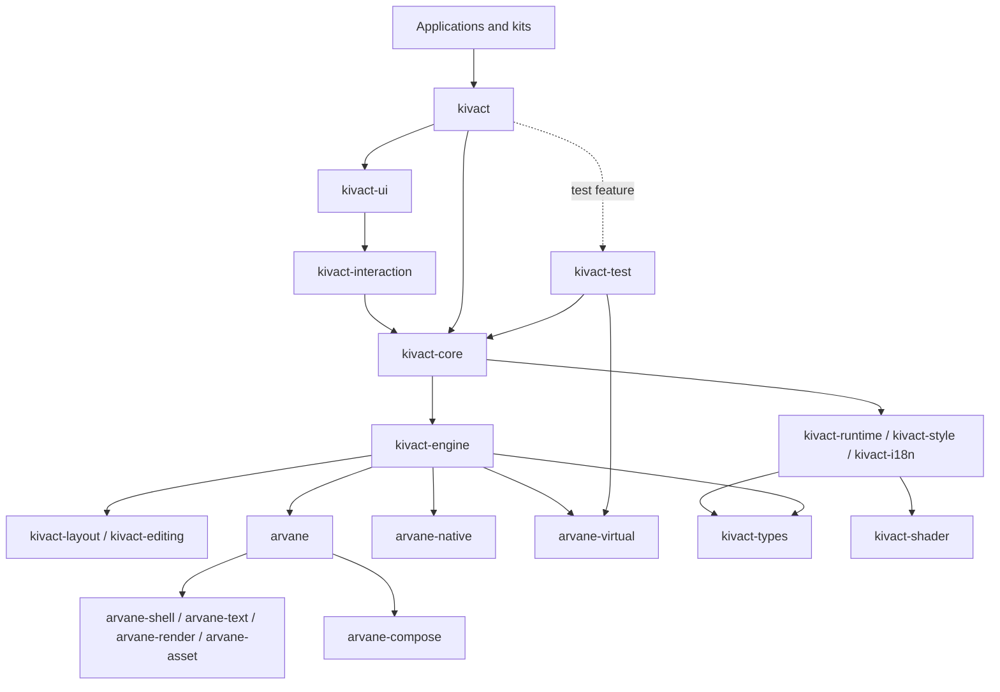

# Kivact

[English](README.md)

Kivact は Rust のネイティブ GUI フレームワークです。コンポーネントは一度だけ実行される普通の関数で、細粒度のシグナルが、値を読んでいる画面の部分だけを更新します。React や SolidJS の経験がある開発者になじみのある考え方で、アプリの Rust のドメインロジックと同じコードベースに UI を置けます。

> **状態: 初期開発版。** API と crate の構成は予告なく変わり、リリースはまだありません。不具合の報告は issue で受け付けます。pull request は当面受け付けません。

```rust,no_run
use kivact::prelude::*;

fn counter() -> impl IntoView {
    let count = signal(0);
    column((
        text(move || format!("回数: {}", count.get())),
        button("増やす").on_press(move || count.update(|n| *n += 1)),
    ))
    .style(style().gap(8).padding(16))
}

fn main() -> kivact::Result<()> {
    App::new("Counter").run(counter)
}
```

App の root setup は mount 時に一度だけ実行されます。子の setup と cleanup を
独立した owner に置くには `scope(move || view)` を使います。変化する property は
closure の中で signal を読みます。実行時の画像・font の入力には所有する `Vec<u8>` や
`AssetBytes` を渡せます。同じ asset を再利用するときは保持した値を clone し、cache の
identity を維持します。

## 特徴

- **普通の関数とシグナル。** `signal`・`memo`・`effect` と key 付きの一覧。仮想 DOM はなく、コンポーネント全体を再実行しません。
- **標準コンポーネント。** button・入力欄・select・dialog・menu・tabs・表・toast などを `kivact::ui` に持ち、見た目は有効なテーマが決めます。
- **既定でアクセシブル。** どのコンポーネントも役割・名前・状態を OS の支援技術へ出し、キーボードで操作できます。
- **App 全体のテスト。** `kivact::test` は `arvane-virtual` の上で実アプリと同じ描画 driver と仮想時計を使い、役割と名前で App 全体を操作します。手元では実 window に mirror できます。
- **文字と入力。** CJK・結合文字・双方向テキスト・IME の変換を扱います。
- **描画。** HTML Canvas に近い語彙の Canvas、アプリ自身の renderer が描いた frame の表示、ウィンドウなしの画像の書き出しを持ちます。
- **UI キット。** 5 つの公式キットが標準コンポーネントの見た目を差し替え、分野別のコンポーネントを足します。キットは公開 API だけで作られています。

## はじめに

Kivact はまだ crates.io に公開していません。Git リポジトリに依存します。

```toml
[dependencies]
kivact = { git = "https://github.com/Kashiwade-music/kivact" }

[dev-dependencies]
kivact = { git = "https://github.com/Kashiwade-music/kivact", features = ["test"] }
```

ツールチェーンは [`rust-toolchain.toml`](rust-toolchain.toml) で固定しています。まず [チュートリアル](docs/for-kivact-user/jp/getting-started/README.md) から始めてください。

サンプルは、リポジトリを clone してルートで実行します。

```text
cargo run -p kivact-example-counter
cargo run -p kivact-example-form
cargo run -p kivact-example-list
cargo run -p kivact-example-async
cargo run -p kivact-example-component
cargo run -p kivact-ui-basic-catalog
```

## ドキュメント

| 対象 | 日本語 | English |
|---|---|---|
| アプリの開発者 | [Kivact ガイド](docs/for-kivact-user/jp/README.md) | [Kivact guide](docs/for-kivact-user/en/README.md) |
| UI キットの利用者 | [UI キット ガイド](docs/for-kivact-ui-user/jp/README.md) | [UI kit guide](docs/for-kivact-ui-user/en/README.md) |
| Kivact の開発者 | [アーキテクチャ](docs/for-kivact-developer/architecture.md)、[設計の決定](docs/for-kivact-developer/decisions.md)、[製品戦略](docs/for-kivact-developer/strategy.md) | — |

API リファレンスは rustdoc です: `cargo doc -p kivact --open`

## Workspace の crate

workspace は 47 package で構成します。アプリは `kivact` と必要な UI キットを使います。
内部の library は runtime、engine、backend、test harness の責務で分かれています。
図は主な依存経路です。全体は [アーキテクチャ](docs/for-kivact-developer/architecture.md) と
[生成した依存図](architecture/) を参照してください。



| Crate | パス | 用途 |
|---|---|---|
| `kivact` | `crates/kivact` | アプリ・部品作者向けの公開入口。 |
| `kivact-core` | `crates/kivact-core` | view の記述、mount、入力、アプリ起動。 |
| `kivact-test` | `crates/kivact-test` | kivact::test の App 全体 E2E ハーネス。 |
| `kivact-devtools-protocol` | `crates/kivact-devtools-protocol` | DevTools の agent・アプリ・MCP・Python client が共有する通信の語彙。 |
| `kivact-devtools-agent` | `crates/kivact-devtools-agent` | target のアプリの中で動く DevTools の server。socket、discovery、PNG。 |
| `kivact-devtools-client` | `crates/kivact-devtools-client` | DevTools の agent の discovery と型付きの呼び出し。 |
| `kivact-devtools` | `crates/kivact-devtools` | DevTools のデスクトップアプリ。 |
| `kivact-devtools-mcp` | `crates/kivact-devtools-mcp` | DevTools の target を stdio で公開する MCP server。 |
| `kivact-public-api-tests` | `dev/tests/kivact-public-api` | 公開 API 利用者の E2E と offscreen の契約。 |
| `kivact-runtime` | `crates/kivact-runtime` | reactive owner、signal、Machine、task、motion。 |
| `kivact-i18n` | `crates/kivact-i18n` | locale、message、日付・数値の書式。 |
| `kivact-style` | `crates/kivact-style` | style、theme、token、描画の語彙。 |
| `kivact-shader` | `crates/kivact-shader` | ユーザーの WGSL の検証と shader module の組み立て。 |
| `kivact-interaction` | `crates/kivact-interaction` | 表示を持たない振る舞い、semantics、入力 controller。 |
| `kivact-ui` | `crates/kivact-ui` | 標準部品と recipe の契約。 |
| `kivact-ui-basic` | `crates/kivact-ui-basic` | shadcn/ui Lyra 風の中立的な汎用キット。 |
| `kivact-ui-pop` | `crates/kivact-ui-pop` | 落ち着いた配色のコンパクトな業務アプリ用キット。 |
| `kivact-ui-game` | `crates/kivact-ui-game` | ゲーム風の操作パネルと HUD。 |
| `kivact-ui-creative` | `crates/kivact-ui-creative` | 制作向けの編集ツール、dock、inspector。 |
| `kivact-ui-soft` | `crates/kivact-ui-soft` | Astryx Neutral のライト・ダークテーマ。 |
| `kivact-engine` | `crates/kivact-engine` | 保持する UI tree、scene の生成、backend の駆動。 |
| `kivact-editing` | `crates/kivact-editing` | document、edit session、native 文字入力の契約。 |
| `kivact-layout` | `crates/kivact-layout` | 借用した tree の layout と派生 geometry。 |
| `kivact-docs` | `dev/tests/docs` | Markdown の Rust 例を doctest で検査。 |
| `kivact-template-basic` | `templates/basic` | 試験付きの最小 standalone アプリ雛形。 |
| `kivact-example-counter` | `examples/kivact/counter` | signal を使う counter の例。 |
| `kivact-example-form` | `examples/kivact/form` | form の検証の例。 |
| `kivact-example-list` | `examples/kivact/list` | key 付き list の例。 |
| `kivact-example-async` | `examples/kivact/async` | resource の読込の例。 |
| `kivact-example-component` | `examples/kivact/component` | 再利用する部品の合成の例。 |
| `kivact-ui-basic-catalog` | `examples/kivact-ui-basic` | basic キットの対話的カタログ。 |
| `kivact-ui-pop-catalog` | `examples/kivact-ui-pop` | pop キットの対話的カタログ。 |
| `kivact-ui-game-catalog` | `examples/kivact-ui-game` | game キットの対話的カタログ。 |
| `kivact-ui-creative-catalog` | `examples/kivact-ui-creative` | creative キットの対話的カタログ。 |
| `kivact-ui-soft-catalog` | `examples/kivact-ui-soft` | soft キットの対話的カタログ。 |
| `arvane` | `crates/arvane` | 移植可能な window、text、render、asset の入口。 |
| `kivact-types` | `crates/kivact-types` | 中立な geometry、event、asset、不変 snapshot。 |
| `arvane-native` | `crates/arvane-native` | 実 window、入力、表示、accessibility。 |
| `arvane-shell` | `crates/arvane-shell` | backend SPI と移植可能な window・入力の語彙。 |
| `arvane-virtual` | `crates/arvane-virtual` | 共通描画 driver を使う台本 backend と任意の実窓 mirror。 |
| `arvane-text` | `crates/arvane-text` | font の探索と text shaping adapter。 |
| `arvane-render` | `crates/arvane-render` | RenderScene のラスタライズ（Vello）。 |
| `arvane-compose` | `crates/arvane-compose` | Composition の plan と、その CPU・GPU の合成。3D、cache、shader、外部 texture を Vello の外で合成する。 |
| `arvane-asset` | `crates/arvane-asset` | 画像・font の読込、decode、asset cache。 |
| `kivact-gpu-share` | `crates/kivact-gpu-share` | GPU texture 共有の契約と native helper（実験的）。 |
| `gpu-interop-producer` | `dev/tests/gpu-interop-producer` | GPU 共有の試験で使う独立 renderer。 |
| `xtask` | `dev/xtask` | workspace 検査と architecture 図の生成。 |

## `kivact` の Cargo feature

| Feature | 既定 | 説明 |
|---|---|---|
| `gpu` | 有効 | GPU で描画し、使えなければ CPU に切り替えます。無効にすると CPU だけで build します。`ARVANE_RENDERER=cpu` で実行時に CPU へ固定できます。 |
| `test` | 無効 | `kivact::test` の App 全体の仮想 E2E と任意の実窓 mirror。 |
| `devtools` | 無効 | アプリ内の DevTools の agent。別アプリの DevTools、MCP server、Python client から使います。有効にした release build は起動時に警告を出します。 |
| `tokio` | 無効 | 非同期 task の Tokio 連携。 |
| `embed` | 無効 | 実験的。ホストのウィンドウの中にアプリを開きます（オーディオプラグインの editor など）。 |
| `gpu-interop` | 無効 | 実験的。アプリ自身の renderer の GPU texture を、読み戻さずに表示します。 |

## 対応プラットフォーム

| プラットフォーム | 状況 |
|---|---|
| Windows | 主対象。 |
| Linux（Wayland、X11） | 主対象。デスクトップ環境・IME・スクリーンリーダーの確認は一部です。 |
| macOS | 未対応。 |
| Android、iOS | 設計では考慮していますが、未対応です。 |

## リポジトリの構成

| パス | 内容 |
|---|---|
| `crates/` | フレームワーク、ネイティブホスト、UI キット |
| `examples/` | 小さなアプリとキットのカタログ |
| `templates/basic/` | テスト付きの最小のアプリ |
| `docs/` | 利用者ガイド、恒久的な architecture・decisions・製品戦略 |
| `dev/` | ワークスペースの検査と公開 API のテスト |
| `architecture/` | 生成した crate と module の依存関係の図 |

## 開発への参加

当面は作者だけが開発します。[CONTRIBUTING](CONTRIBUTING.md) を参照してください。脆弱性は [SECURITY](SECURITY.md) の手順で非公開に連絡してください。

## ライセンス

Copyright (c) 2026 Kashiwade。[MIT](LICENSE-MIT) または [Apache-2.0](LICENSE-APACHE) のいずれかを選んで利用できます。同梱するフォントとアイコンはそれぞれのライセンスに従います。[THIRD-PARTY-NOTICES](THIRD-PARTY-NOTICES.md) を参照してください。
