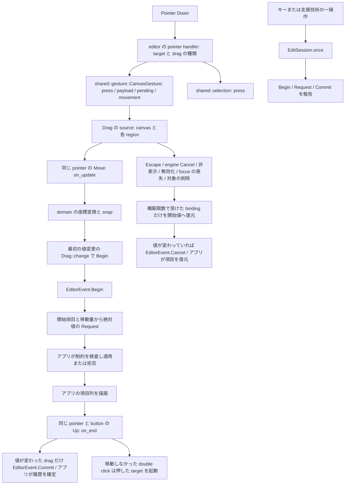
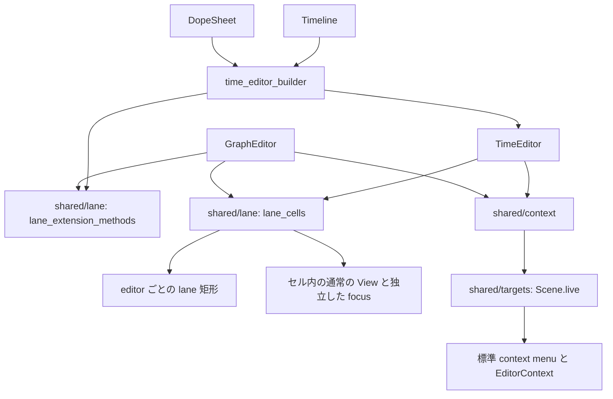

# Creative editor の編集と lane 拡張

公式 kit はアプリの項目列を `impl IntoValue<Vec<T>>` で読取専用に受ける。
`timeline` と `dope_sheet` は時間単位の Clip/Keyframe、`graph_editor` は Curve/CurveKey、
`node_editor` は NodeData/NodeLink、`arrangement` は clip と track を受ける。
lane は index ではなく安定した u64 ID で識別し、反応する lanes の一覧から表示を決める。
各 editor は `on_edit(|event: EditorEvent<R>| ..)` で変更を要求し、アプリが適用または拒否する。
要求の型は `TimeRequest`・`GraphRequest`・`NodeRequest`・`ArrangementRequest` で分ける。
履歴と項目の開始値の保存・復元はアプリが持ち、kit は patch/history の別 model や既定の apply 関数を持たない。
中核の `EditSession` は、構築関数で受けた view の状態（`TimeState` などの binding）と単一の値だけを復元する。
`color_wheel`、`bezier_curve`、`gradient_editor` は単一の値を binding で編集する独立した部品である。

## 編集の transaction

`EditorEvent::Begin` でアプリが項目の開始値を保存し、`Request(R)` を適用または拒否し、`Commit` で一件の履歴を確定する。
`Cancel` では kit が bind する値はすでに復元されており、アプリが項目を Begin の状態へ戻す。
キーと支援技術の一操作も、`EditSession::once` で Begin/Request/Commit を報告する。
`EditSession::once` は単独なら Begin/Commit を作り、既存の編集がある場合はその編集に含める。

domain editor の gesture は一つの `Drag`（`use_drag(..).edit_on_change(session, start)`）で動く。
押下ではなく最初の値の変更で Begin するのは、動かない押下が選択や起動だからである。
drag の source は canvas の root と、描画した各 region の part に付ける。
region の上の press はその region の source が受け、region の native な起動を妨げない。
editor の pointer handler は Down だけを見て、押した target・修飾キー・ボタンから drag の種類と開始値を決め、event を source へ渡す。
drag を始めない press（ツールの一操作、起動だけの target）はそこで消費する。
Move・Up・Cancel は drag の `on_update`・`on_end` が受ける。
押下で値を書く gesture（playhead の移動、automation point の追加）は `on_start` で書く。
値の変更はすべて `Drag::change` を通し、最初の変更の直前に `EditorEvent::Begin` を出す。
変更なしに終わった drag は何も通知しない。
drag 中の Escape と engine の Cancel は drag が止め、始まっていた編集を取り消す。kit は Escape を手で扱わない。
editor の key handler は drag の source の後の part（`region_events`）に置き、drag 中でない Escape だけを受けて選択を空にする。
非表示・focus の喪失・対象の削除では editor が `Drag::cancel` を呼ぶ。
中ボタンの pan は `Drag::buttons([MouseButton::Middle])` で同じ drag が受ける。
node は中ボタンと Space の pan を中核の `ZoomPan` に任せ、その間は drag を disabled にする。
outliner の行と dock の tab の drag も Escape を drag の source に任せ、取消しの後始末は `on_end` の Cancel で行う。
数値・色・Bezier・gradient の drag の取消しは `Drag::edit`（数値は `Scalar::scrub`）が担う。
range は `use_range_scalar` の track・thumb・body をそのまま使い、track の比の計算と区間の移動を自前で持たない。
一つの focus を root に残すため、端の region は `focusable(false)` にし、キーは最後に押した・選んだ・動いた端（か区間）を動かす。
入力中の draft は、`outliner.rs` の行名、`dock/chrome.rs` の tab 名、`numeric.rs` の数値、`color_wheel/fields.rs` の HEX 入力のどれも、標準の `text_input(..).draft(on_commit)` で持つ。Enter が確定し、Escape と focus を失う操作は `EditSession` の規則で終わり、`.return_focus(node)` が focus を戻す。
これらとは別に、outliner の制限の塗り操作は行の中の button の押下から始まり、focus は行にあるので、drag の source の Escape では届かない。
node の parameter popup の編集は drag ではない `EditSession` で、popup を閉じる Escape と同じ key で取り消す。
この二つの編集の取消しは `EditSession::cancel` を呼び、取消しの値の書き戻しは session が行う。

private な `editors/shared/gesture::CanvasGesture<Target, Drag>` は押下位置と現在位置、target、domain の drag と開始 snapshot を含む payload、保留した単独選択、修飾キー、double click と移動の記録を一つに保持する。
四つの domain の input は同じ `install` で `on_update`・`on_end` を付ける。終了時には最後の motion、矩形選択、静止時だけの保留した Replace、後始末、静止した主ボタンの double click の起動の順に進む。Cancel は後始末だけを行う。
pointer の同一性・button・release の照合、編集の確定と取消しは既存の `Drag`・`EditSession` が持つ。
値が snap により変わらなくても、一度 pointer が動けば元の位置へ戻っても移動の記録は残る。これにより移動後の単独選択や double click 起動を防ぐ。
ドラッグによる移動の各 Request は Begin 時の項目と pointer の移動量から計算する絶対的な提案であり、
前の要求をアプリが反映したかどうかに依存しない。
アプリは最新の移動提案だけを適用でき、無視すれば項目の描画は動かない。
異なる field の編集を混ぜないための domain ごとの入力 guard は editor が持つ。

outliner の制限の塗り操作は `EditorEvent<Restriction>`、改名・drop と table の行移動は個別の callback で報告する。
仮のリンク線・marquee・drop 先の線は kit のローカル状態に保つ。
ID・名前・素材の開始位置・接続規則・長さの制約はアプリが決める。
editor の view の状態（選択・playhead・loop・zoom・pan・tool・展開）は、editor ごとの `…State`
（`ArrangementState`・`TimeState`・`GraphState`・`NodeState`・`OutlinerState`・`ChannelState`）の binding として、
数値・色・Bezier・gradient の単一の値は binding として構築関数で受け、kit は隠れた signal を作らない。
gradient stop は ID を持たず一覧内の index で識別する。
basic・game の項目列にも同じ境界を適用し、追加と削除は個別の callback で報告する。

## 共有する private module

private な `editors.rs` が domain と共有層を束ね、crate root は従来の公開型・構成関数を明示的に再公開する。

| domain | 配置 |
|---|---|
| time | `time.rs` が Timeline/DopeSheet の組立て。`model`・`view_state`・`gesture`・`input`・`edit`・`layout`・`paint`・`a11y` を子に持つ |
| graph | `graph.rs` が組立て。上記の責任に `a11y` を加え、Curve・GraphView・Interpolation は `model` に置く |
| node | `node.rs` が組立て。`model`・`view_state`・`gesture`・`input`・`edit`・`layout`・`paint`・`a11y`・`parameters` に分ける |
| arrangement | `arrangement.rs` が組立て。同じ責任の子を持ち、受動的な target registry と固有の texts は `a11y/` に分ける |

`shared/model` は Clip・Lane・ItemTime・EditorContext・EditorEvent、`shared/ruler/data` は ruler の受動的な設定を持つ。domain の builder や view state への逆参照を作らない。
`shared/metrics` は寸法、`shared/targets` は型付き region 対応、`shared/ruler` は目盛りを受け持つ。
`shared/context` は pointer の押下時の snapshot、コンテキストメニューキー、region・active・選択からの要求を共有し、domain の fallback は各 domain に置く。
`shared/geometry` は pointer を中心にした wheel の倍率・offset を計算する。矩形は公開の `Rect::from_points`、交差は辺も含む `Rect::intersects` を使う。Arrangement は横を f64 の beat、縦を lane 座標へ写してから矩形選択の hit を調べる。
`shared/selection` は選択済み項目の押下と marquee の追加選択を共有し、修飾キーの選択規則は同じ ListPolicy を渡す公開の `ListGesture::from_modifiers` に委ねる。
ChannelState・OutlinerState はそれぞれ audio・outliner の `view_state` に置く。dock と splitter recipe は下位の `dock_style`、通常の control の外観は `control_style` を使う。
node の view の pan と zoom は中核の `ZoomPan` に委ねる。

Canvas の domain と region の対応は `shared/targets` に集約する。
アプリの u64 ID と region ID を分け、削除した target の region ID は再利用しない。
重複した target は診断し、その scene の操作を止める。
`Scene::live` で target の生存を判定し、scene が失効した target の起動・menu 要求は受け付けない。
汎用の RegionMap は公開しない。

segmented control は標準の `radio_group` に kit の型 `Segmented` を `.variant(..)` で渡し、既定の slot で描く。
kit は分野の座標と描画を持つ。

## lane 拡張

`time_editor_builder` は Timeline と DopeSheet の型・構築関数・builder・NodeBuilder/IntoView を生成する。
`shared/lane` の `lane_extension_methods` は `lane_cell`・`on_lane_activate`・`on_item_activate`・`context_menu` の
4 つの builder method を一つの macro から生成し、標準の menu factory と keyed lane cell の配置を共有する。
セルの配置は共通処理へ lane 矩形を渡す。
time の中央揃えの row と graph の通常の node の差は矩形関数の引数で表し、子の focus と入力の隔離を保つ。
セルに focus がある間は editor の選択や drag を始めない。

## arrangement

arrangement の描画、空 lane の入力、矩形選択、automation の移動は `track_layout` の `TrackRow` を共有し、
縦 pan の下限も内容と viewport の高さから求める。
loop・playhead・追加操作は描画した型付き region で振り分け、ruler の region は sidebar の外へ切り詰める。
`LoopPart::Create` は空の ruler からの loop 作成を保つ。
track の 4 種の状態（mute・solo・arm・automation read）は `TrackFlag` で識別し、region の種類は `TrackSwitch` である。
region の ID がない場合は描画・意味情報を出さない。
Clip の有限性と正の長さは `drawable` で一度定義し、time editor も同じ判定を使う。
長さ 0 の Keyframe は点として有効とする。
無効な item が外部の選択値に残っていても、time editor は snapshot にない item を編集しない。

## outliner

outliner は中核の `Tree<u64>` を使い、各 `TreeItem` から `TreeNode`（選択できない項目は disabled）と expanded の binding を作る。
展開は項目列とは別の expanded binding へ書く。
行の drag は `Drag` の source で、pointer の高さが行の上・下・中央の 1/3 のどこにあるかから、
兄弟の前・兄弟の後・最後の子への `TreeDrop { id, target, after }` を作る。
自身と自身の部分木へは drop できない。
`on_item_drop` がある場合だけ drag を有効にして要求を報告し、親と順序の変更はアプリが反映する。
`active` は選択とは別の現在の項目で、印と checked を出す。
`reveal_active` は `active` が変わったときに祖先を開いて scroll into view するが、自身の行の押下による変更と mount 時の初期値は除く。
固定幅のセル内の press とキーは行の選択・drag・改名から隔離し、Tab と子の control の native な起動を保つ。

## viewport_surface

`viewport_surface` はアプリの Pixels を表示し、fit、DPI を含む resize、絵の座標へ戻した pointer、同じ transform の overlay と region を提供する。
node と surface の拡大・pan は中核の zoom_pan に委ねる。
実験 feature `gpu-interop` の `gpu_frame` は、アプリの engine が GPU で共有した frame（`kivact::gpu_interop`）を、`adapter()` が `Some` のときだけ `Pixels` の代わりに表示する。寸法は表示している方の画像のものを使う。
3D・合成・scope の計算はアプリが行い、worker の frame は非同期 channel と spawn で受けて image の signal に書く。

crate と module 全体の依存図は [`architecture/`](../../../architecture/) に生成する。
この図は編集の契約と拡張の接続を説明し、依存図は循環や層の向きを確認する。
